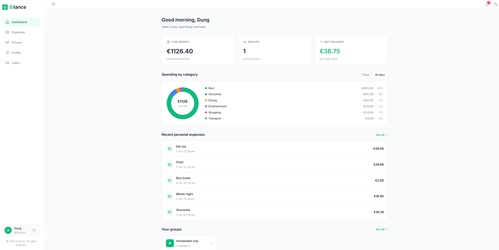
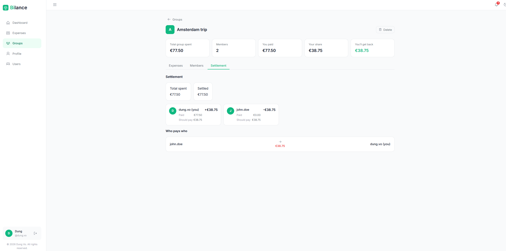

# Bilance

[](https://github.com/dung-vo01/bilance/actions/workflows/ci.yml)

A full-stack expense tracker for splitting shared costs with friends,
roommates, or any group - personal expenses and group expenses with
custom split ratios, invites, and a settlement view showing who owes who.

**<a href="https://bilance.vercel.app/" target="_blank" rel="noopener noreferrer">Live demo</a>**

The same frontend is deployed to two hosts, both calling the same API and
database:

| Host | URL | How it is deployed |
| --- | --- | --- |
| Vercel | <a href="https://bilance.vercel.app/" target="_blank" rel="noopener noreferrer">bilance.vercel.app</a> | CI job `deploy-frontend` (Vercel CLI) |
| AWS S3 + CloudFront | <a href="https://d8jwj1s3y6g2n.cloudfront.net/" target="_blank" rel="noopener noreferrer">d8jwj1s3y6g2n.cloudfront.net</a> | CI job `deploy-frontend-aws` (GitHub OIDC, no stored AWS keys) |

Both are updated on every push to `main`. The AWS one exists to practise
hosting a static site on AWS; the CloudFront address is a generated name
because the project has no custom domain yet. See
[`infra/README.md`](infra/README.md#frontend-hosting-s3--cloudfront).

> **Note:** the backend is on a free-tier host and spins down when idle, so
> the first request can take up to a minute to wake it back up. The app
> shows a "waking up the server" message during that wait so it doesn't
> look stuck; subsequent requests are fast.

> **Email is optional.** The live demo runs with email **off**
> (`EMAIL_ENABLED=false`): signup logs you in immediately, and there is no
> password recovery. Email (verification, password reset, invitations) uses
> Amazon SES, which is still in **sandbox mode** and only delivers to
> verified addresses, so it cannot be turned on for real users until there is
> a sender domain. See [`backend/README.md`](backend/README.md#email).

## Screenshots




## Features

- Auth with JWT access/refresh tokens; email verification and password reset
  are an optional add-on (`EMAIL_ENABLED`)
- Guest mode - try the app instantly with a pre-seeded sandbox account, no
  signup required
- Personal expense tracking - search, sort, filter by category/status,
  paginated
- Expense groups - create, invite by username, accept/decline, admin
  controls
- Per-expense split ratios, independent of a group's default ratio
- Settlement view - who owes who, and by how much, with expenses that are
  still awaiting a split shown separately
- Repayments - resolve a "who pays who" entry once it's paid, undo it with a
  note if it wasn't, and keep a full payment history
- Per-IP rate limiting on the API, with stricter limits on login, signup and
  email-sending routes
- Global and per-group expense categories
- Contacts/friends system - send, accept, or decline friend requests; only
  contacts (or people you already share a group with) can be invited to a
  group. A dedicated Friends page lists your contacts (with each other's
  email/phone visible, and a jump link to any shared groups), plus incoming
  and outgoing pending requests with cancel/unfriend controls
- Notifications for invitations, membership changes, and friend requests,
  with email notifications for group invitations and incoming friend
  requests

## Tech stack

- **Frontend** - React, TypeScript, Vite, TanStack Query, Zustand, SCSS modules
- **Backend** - FastAPI, SQLAlchemy 2.0 (async), PostgreSQL, Alembic, optional
  Redis for shared rate-limit counters
- **Auth** - JWT (access + refresh), bcrypt password hashing, email
  verification via Amazon SES (optional)

## Project structure

```
backend/    FastAPI app  - see backend/README.md
frontend/   React app    - see frontend/README.md
infra/      AWS pieces (frontend hosting, API on EC2, guest cleanup) - see infra/README.md
docs/       design notes (expense sharing & settlement rules)
```

## Getting started

Follow the setup steps in [`backend/README.md`](backend/README.md) and
[`frontend/README.md`](frontend/README.md) to run the API and the app
locally.

## Roadmap

- Recurring payments
- Payment due-date reminders
- Phone number registration
- Receipt image upload with AI-assisted data extraction

## License

&copy; 2026 Dung Vo. All rights reserved.
